<p align="center">
  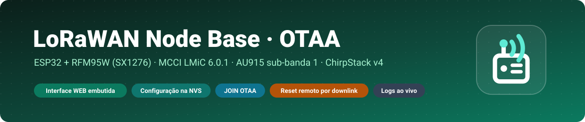
</p>

<p align="center">
  
</p>

**LoRaWAN Node Base OTAA** é o firmware base de um nó LoRaWAN com **ESP32** e rádio **RFM95W (SX1276)**, ativação **OTAA** (JOIN over-the-air), stack **MCCI LMiC 6.0.1**, plano **AU915 sub-banda 1** e servidor **ChirpStack v4**.

Ele é a camada de firmware de um projeto maior de medição de energia elétrica em tempo real, ponta a ponta, com backend em **Java/Spring**, frontend em **TypeScript/Angular** e app em **Dart/Flutter**, e serve de ponto de partida para qualquer sensor que precise enviar dados por LoRaWAN.

Na **versão 1.1**, tudo o que antes era editado no código-fonte (DevEUI, JoinEUI, AppKey, canais, data rate, potência, intervalo, payload, comando de reset remoto, pinos, Wi-Fi…) é configurado por uma **página WEB servida pelo próprio ESP32** e fica gravado na **NVS**. Não é preciso recompilar para trocar de rede, de chave ou de pino.

<p align="center">
  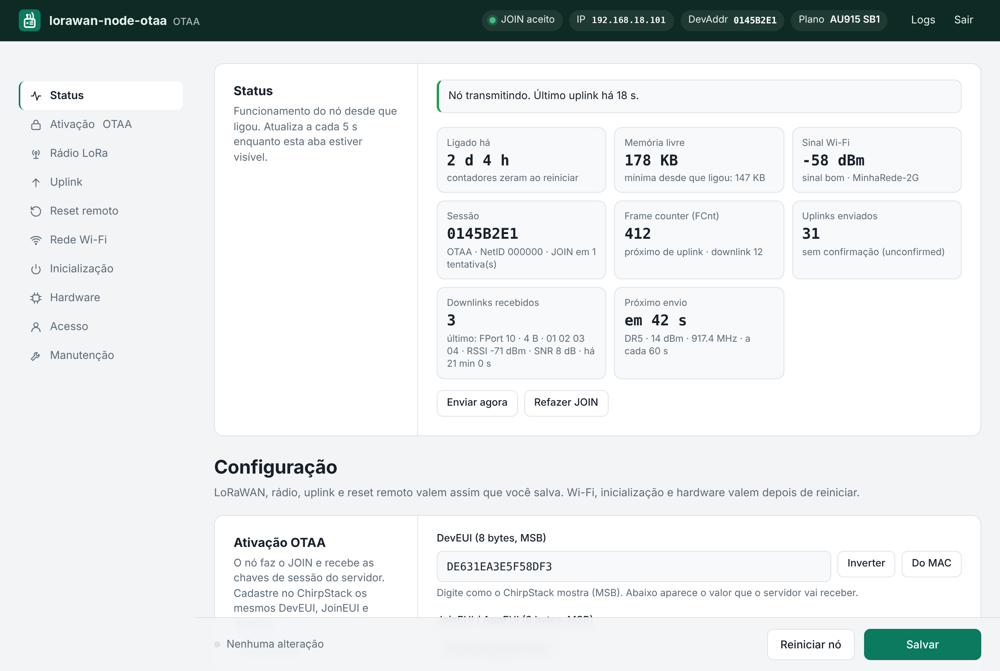
</p>

> Repositório irmão: **[ABP](https://github.com/AdailSilva/esp32-lorawan-abp-au915-chirpstack)** (mesmos arquivos `node_*`, só muda o `node_build.h` e o sketch). Gateway usado nos testes: **[ESP32_SX1302](https://github.com/AdailSilva/ESP32-with-SX1302-Gateway)**.

---

## Sumário

- [Novidades da versão 1.1](#-novidades-da-versão-11)
- [Funcionalidades](#-funcionalidades)
- [Onde o nó entra na rede](#-onde-o-nó-entra-na-rede)
- [Arquitetura do firmware](#-arquitetura-do-firmware)
- [Hardware](#-hardware)
- [Ligação ESP32 ↔ RFM95W](#-ligação-esp32--rfm95w)
- [Compilar e gravar](#-compilar-e-gravar)
- [Primeiro uso](#-primeiro-uso)
- [Interface WEB](#-interface-web)
- [Parâmetros e valores de fábrica](#-parâmetros-e-valores-de-fábrica)
- [Console serial](#-console-serial)
- [Plano de canais AU915](#-plano-de-canais-au915)
- [JOIN OTAA](#-join-otaa)
- [Ordem dos bytes do DevEUI/JoinEUI](#-ordem-dos-bytes-do-deveuijoineui)
- [Reset remoto por downlink](#-reset-remoto-por-downlink)
- [Diagnóstico de sessão e MIC](#-diagnóstico-de-sessão-e-mic)
- [Saída no Serial Monitor](#-saída-no-serial-monitor)
- [Cadastro no ChirpStack](#-cadastro-no-chirpstack)
- [Diferenças em relação ao ABP](#-diferenças-em-relação-ao-abp)
- [Solução de problemas](#-solução-de-problemas)
- [Estrutura do repositório](#-estrutura-do-repositório)
- [Licença e autor](#-licença-e-autor)

---

## 🆕 Novidades da versão 1.1

| Recurso | O que mudou |
|---|---|
| 🖥️ **Interface WEB** | Página em português, no mesmo visual da página do gateway ESP32_SX1302: status ao vivo, configuração completa, logs, tema claro/escuro e layout para celular |
| 💾 **Configuração na NVS** | Tudo o que era `#define` agora vem da NVS. O `node_build.h` guarda só os valores de fábrica |
| ⚡ **Aplica sem reiniciar** | Chaves, rádio, uplink e reset remoto valem assim que você salva (mudança de chaves ou canais refaz o JOIN) |
| 📶 **Wi-Fi resiliente** | Station com **Soft AP de emergência** e portal cativo, IP fixo ou DHCP, `http://<nome>.local`, ou Wi-Fi desligado |
| 🔘 **Botão BOOT** | Segurar **3 s** abre o Soft AP a qualquer momento |
| 🧵 **Sem atrapalhar o LoRa** | O servidor WEB roda numa task no **core 0**; o LMiC continua sozinho no core 1, sem atrasar as janelas RX1/RX2 |
| 🔄 **Reset remoto configurável** | FPort, bytes do comando (1–16), espera e liga/desliga pela página |
| 🔁 **Ordem dos bytes do EUI** | A página mostra qual DevEUI/JoinEUI o ChirpStack vai receber e permite escolher entre o comportamento da 1.0 e o padrão LSB do MCCI ([detalhes](#-ordem-dos-bytes-do-deveuijoineui)) |
| 📟 **Console serial** | `help`, `status`, `wifi_ap`, `web_auth --reset`, `send`, `rejoin`, `cfg_reset`, `reboot` |

---

## ✨ Funcionalidades

### LoRaWAN e rádio

| Função | Detalhe |
|---|---|
| Ativação **OTAA** | DevEUI + JoinEUI + AppKey; JOIN automático com novas tentativas; botão “Do MAC” gera um DevEUI único |
| Canais AU915 | Sub-banda 0–7, canal de 500 kHz opcional, ou lista própria (`8-15,65`) |
| Data rate e potência | DR0–DR6, 2–20 dBm, **ADR** liga/desliga, **link check** liga/desliga |
| Janela RX2 | Data rate (DR8–DR13) e frequência |
| Erro de relógio | 0–10 % de `MAX_CLOCK_ERROR` para alargar a janela de recepção |
| Uplink | Intervalo, FPort, confirmado ou não, payload em **texto ou hexadecimal** (até 222 bytes), com cálculo do **tempo no ar** e da ocupação do canal |
| Downlink | Class A (RX1/RX2); FPort, bytes, RSSI e SNR do último downlink no painel |
| Reset remoto | Comando validado byte a byte numa FPort dedicada |


### Interface WEB e operação

| Função | Detalhe |
|---|---|
| Status ao vivo (5 s) | Uptime, memória, RSSI do Wi-Fi, sessão, FCnt, uplinks/ACKs, último downlink, próximo envio |
| Ações | **Enviar agora**, **Refazer JOIN** |
| Login | HTTP Basic (padrão `admin` / `lorawan`), botão **Sair** |
| Logs | Tudo o que sai no Serial Monitor, ao vivo, com filtro, pausa e download (buffer de 16 KB em RAM) |
| Manutenção | Exportar/importar a configuração em JSON (sem senhas) e restaurar padrão de fábrica |
| Validação | No navegador e de novo no ESP32: chaves com tamanho exato, IPs, pinos repetidos ou só-entrada, canais, faixas numéricas |

---

## 🌐 Onde o nó entra na rede

<p align="center">
  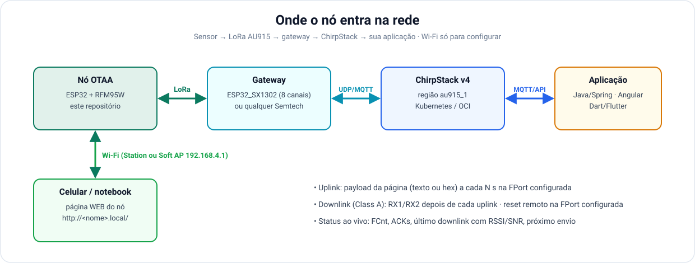
</p>

O Wi-Fi do nó serve **só para configurar e acompanhar**. Os dados vão sempre por LoRa até o gateway. Se o nó fica longe de qualquer Wi-Fi, use o modo **Soft AP** ou deixe o Wi-Fi **desligado** e abra o Soft AP pelo botão BOOT quando precisar.

---

## 🧱 Arquitetura do firmware

<p align="center">
  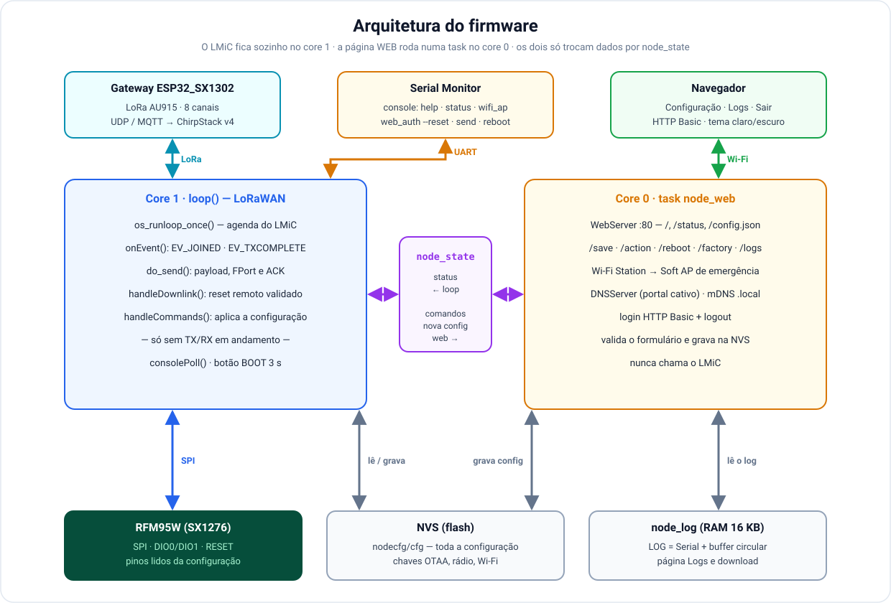
</p>

O LMiC **não é thread-safe** e as janelas RX1/RX2 são sensíveis a atraso. Por isso o servidor WEB roda numa **task própria no core 0**, e o `loop()` (LMiC) continua sozinho no core 1. A página nunca chama o LMiC: ela publica **comandos** e a **nova configuração** em `node_state`, e o `loop()` aplica quando não há TX/RX em andamento.

| Arquivo | Conteúdo |
|---|---|
| [`LoRaWAN_Node_Base_OTAA.ino`](LoRaWAN_Node_Base_OTAA.ino) | Sketch: eventos do LMiC, uplink, reset remoto, aplicação da configuração, console, botão BOOT |
| [`node_build.h`](node_build.h) | **Único arquivo diferente entre ABP e OTAA**: modo de ativação e valores de fábrica |
| [`node_config.h`](node_config.h) / [`.cpp`](node_config.cpp) | Estrutura da configuração, NVS (namespace `nodecfg`), validação e utilitários (hex, lista de canais) |
| [`node_state.h`](node_state.h) / [`.cpp`](node_state.cpp) | Status (loop → web) e comandos/configuração (web → loop) com spinlock/mutex |
| [`node_web.h`](node_web.h) / [`.cpp`](node_web.cpp) | Wi-Fi (Station, Soft AP, portal cativo, mDNS) e servidor WEB com login |
| [`node_page.h`](node_page.h) | Páginas HTML/CSS/JS (na flash, sem internet nem CDN) |
| [`node_log.h`](node_log.h) / [`.cpp`](node_log.cpp) | `LOG` = `Serial` + buffer circular de 16 KB para a página Logs |

---

## 🔧 Hardware

| Componente | Especificação | Observação |
|---|---|---|
| Microcontrolador | ESP32 com 4 MB de flash (ex.: ESP32-DevKitC, WROOM-32) | Precisa de Wi-Fi para a página; usa os dois núcleos |
| Rádio | RFM95W (HopeRF) — SX1276, 915 MHz | Alimentação e lógica de **3,3 V** |
| Antena | ¼ de onda para 915 MHz (≈ 8,2 cm) ou antena SMA/u.FL | **Nunca** transmita sem antena |
| Botão | BOOT da DevKit (GPIO 0) | Segurar 3 s abre o Soft AP (configurável) |

---

## 📌 Ligação ESP32 ↔ RFM95W

<p align="center">
  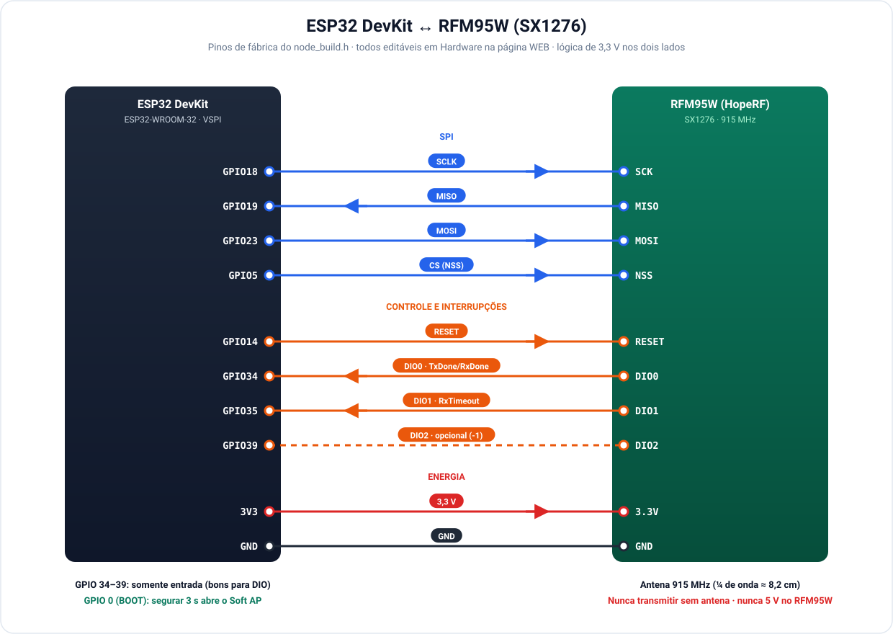
</p>

| ESP32 | RFM95W | Sinal | Campo na página |
|---|---|---|---|
| GPIO 18 | SCK | SPI clock | Hardware → SCLK |
| GPIO 19 | MISO | SPI | Hardware → MISO |
| GPIO 23 | MOSI | SPI | Hardware → MOSI |
| GPIO 5 | NSS | Chip select | Hardware → NSS / CS |
| GPIO 14 | RESET | Reset do rádio | Hardware → RESET (`-1` = não ligado) |
| GPIO 34 | DIO0 | TxDone / RxDone | Hardware → DIO0 |
| GPIO 35 | DIO1 | RxTimeout | Hardware → DIO1 |
| — | DIO2 | Não usado em LoRa | Hardware → DIO2 (`-1`) |
| 3V3 | 3.3V | Alimentação | — |
| GND | GND | Terra | — |

> ⚠️ **GPIO 34–39 do ESP32 são só entrada** e não têm pull-up interno. Servem para DIO0/DIO1 (saídas do rádio), nunca para SCLK, MOSI, NSS ou RESET. GPIO 6–11 são da memória flash. A página recusa essas combinações e pinos repetidos.

---

## 🔨 Compilar e gravar

### Requisitos

| Software | Versão | Observação |
|---|---|---|
| Arduino IDE | 2.x | ou `arduino-cli` / PlatformIO |
| ESP32 Arduino core | **3.x** (testado com 3.3.12) | `WiFi`, `WebServer`, `DNSServer`, `ESPmDNS` e `Preferences` já vêm com o core |
| MCCI LoRaWAN LMIC | **6.0.1**  | região **AU915** no `lmic_project_config.h` |


### 1. Biblioteca LMiC

**Opção A — repositório com a versão usada neste projeto (recomendado):**

```bash
cd ~/Arduino/libraries
git clone https://github.com/AdailSilva/IBM-LMIC-LoRaWAN-MAC-in-C-library-v6.0.1.git MCCI_LoRaWAN_LMIC_library
```

**Opção B — upstream da MCCI com a tag:**

```bash
cd ~/Arduino/libraries
git clone --branch v6.0.1 https://github.com/mcci-catena/arduino-lmic.git MCCI_LoRaWAN_LMIC_library
```

### 2. Região AU915

```cpp
// ~/Arduino/libraries/MCCI_LoRaWAN_LMIC_library/project_config/lmic_project_config.h
#define CFG_au915 1
// #define CFG_us915 1   // comentar as outras regiões
#define CFG_sx1276_radio 1
```

### 3. Baixar o projeto

A pasta precisa ter o **mesmo nome do `.ino`**:

```bash
git clone https://github.com/AdailSilva/esp32-lorawan-otaa-au915-chirpstack.git LoRaWAN_Node_Base_OTAA
```

Abra `LoRaWAN_Node_Base_OTAA/LoRaWAN_Node_Base_OTAA.ino` na Arduino IDE. Os arquivos `node_*` aparecem como abas e são compilados juntos.

### 4. Placa e gravação

| Opção da IDE | Valor |
|---|---|
| Board | **ESP32 Dev Module** (ou a sua DevKit) |
| Partition Scheme | **Default 4MB with spiffs** (o firmware usa ≈ 85 % da partição de 1,2 MB) |
| Upload Speed | 921600 |
| Serial Monitor | **9600 baud**, final de linha **Newline** (a velocidade pode ser mudada na página) |

> Se a flash ficar curta ao acrescentar sensores, use *Partition Scheme → No OTA (2MB APP/2MB SPIFFS)* ou *Huge APP (3MB No OTA)*.

**Uso de memória (ESP32, core 3.3.12, LMiC 6.0.1):** RAM ≈ 25 % (81 KB) · Flash ≈ 85 % (1,11 MB).

### 5. Valores de fábrica (opcional)

Antes de gravar vários nós, ajuste o [`node_build.h`](node_build.h): nome, Wi-Fi, DevEUI/JoinEUI/AppKey, canais, pinos, login. Esses valores só valem no **primeiro boot** ou depois de *Restaurar padrão de fábrica*; depois disso manda o que está na NVS.

---

## 🚀 Primeiro uso

1. **Grave o firmware** e abra o Serial Monitor (9600 baud). O nó já começa a transmitir com os valores de fábrica (faz o JOIN primeiro).
2. **Conecte no Wi-Fi do nó:** rede **`lorawan-node-otaa`**, senha **`lorawan101`**. Em celulares a página abre sozinha (portal cativo); senão, acesse **http://192.168.101.101/**.
3. **Entre** com **`admin` / `lorawan`**.
4. Em **Rede Wi-Fi**, informe sua rede; em **Ativação OTAA**, DevEUI, JoinEUI e AppKey do ChirpStack; ajuste rádio e uplink se precisar. **Salvar**.
5. **Reinicie** pela barra inferior (o Wi-Fi novo vale depois do reinício). A página passa a responder em **http://lorawan-node-otaa.local/** ou no IP que o Serial Monitor mostrar.
6. Troque a senha da página em **Acesso**.

| Situação | Como chegar na página |
|---|---|
| Wi-Fi configurado e conectado | `http://<nome>.local/` ou o IP do roteador |
| Wi-Fi não conecta em 30 s | Abre o **Soft AP de emergência** (mesmo nome/senha). O nó tenta a rede de novo a cada 60 s; quando conecta e ninguém está no AP, o AP desliga |
| Wi-Fi configurado como *Desligado* | Segure o **BOOT 3 s** com o nó ligado, ou digite `wifi_ap` no Serial Monitor |

> ⚠️ Não segure o BOOT **enquanto liga** o ESP32: isso entra no modo de gravação. Ligue primeiro, depois segure 3 s.

---

## 📱 Interface WEB

Servidor HTTP na porta **80**, páginas na flash do firmware (sem internet nem CDN), tema claro/escuro conforme o sistema, layout para celular.

> As capturas foram geradas com o HTML/JS real do firmware, servido com **dados de exemplo**. Os números não são de um nó em campo.

### 🔐 Login

| Item | Detalhe |
|---|---|
| Login padrão | `admin` / `lorawan` |
| Trocar | Seção **Acesso**. Vale na hora; o navegador pede o novo login |
| Esqueceu | No Serial Monitor: `web_auth --reset` |
| Regras | Usuário de 1 a 31 caracteres; senha de 6 a 31; sem `:` |
| Sair | Link **Sair** no topo: troca o login guardado pelo navegador por um falso (`_logout_`) e abre a tela **Você saiu** |
| Senhas | Wi-Fi, Soft AP e página **nunca** voltam para o navegador: o campo aparece vazio com *“Salva (vazio mantém)”* |

### 1. Status

A **barra superior** mostra o nome do nó, o modo (OTAA), o estado da sessão (“JOIN aceito” ou “Aguardando JOIN”), o IP, o DevEUI/DevAddr e o plano. O painel de **Status** atualiza a cada 5 s enquanto a aba estiver visível.

| Cartão | Mostra |
|---|---|
| Ligado há | Uptime (os contadores zeram ao reiniciar) |
| Memória livre | Heap livre e mínimo desde o boot |
| Sinal Wi-Fi | RSSI e rede, ou Soft AP e clientes |
| Sessão | DevAddr, NetID e tentativas de JOIN |
| Frame counter | Próximo FCnt de uplink e FCnt de downlink |
| Uplinks enviados | Total e quantos tiveram ACK (se confirmado) |
| Downlinks recebidos | Total e o último: FPort, bytes, RSSI, SNR, idade |
| Próximo envio | Contagem, DR, potência, frequência do último TX, intervalo |

Enquanto o JOIN não é aceito, o painel avisa e mostra as tentativas:

<p align="center">
  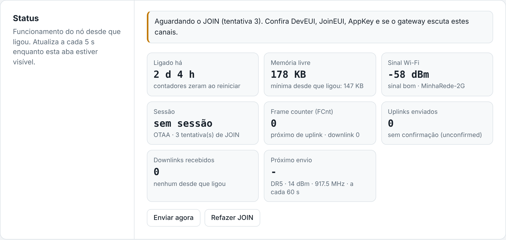
</p>

**Ações:** **Enviar agora** agenda um uplink imediato (respeitando o duty cycle do LMiC) e **Refazer JOIN** descarta a sessão e faz um JOIN novo.

### 2. Ativação OTAA

<p align="center">
  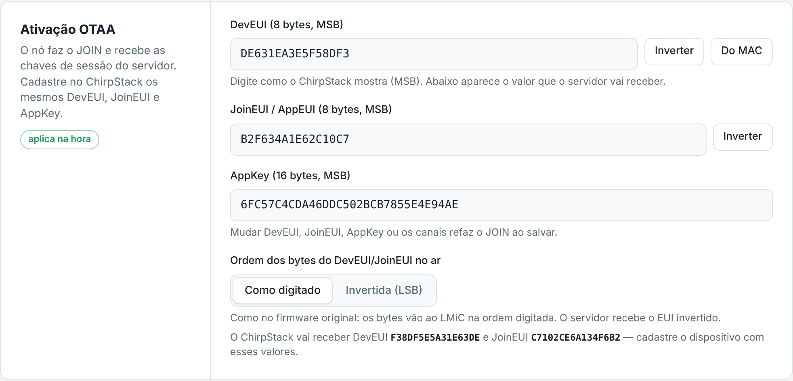
</p>

- **DevEUI:** botões **Inverter** (troca a ordem dos bytes, útil para valores copiados em LSB) e **Do MAC** (gera um EUI-64 único a partir do MAC do ESP32: 3 primeiros bytes + `FFFE` + 3 últimos).
- **JoinEUI/AppEUI** e **AppKey** em MSB, como o ChirpStack mostra.
- **Ordem dos bytes no ar:** veja [Ordem dos bytes do DevEUI/JoinEUI](#-ordem-dos-bytes-do-deveuijoineui). A linha de baixo mostra exatamente o DevEUI e o JoinEUI que o ChirpStack vai receber.
- Mudar DevEUI, JoinEUI, AppKey, ordem dos bytes ou canais **refaz o JOIN** ao salvar.

### 3. Rádio LoRa

<p align="center">
  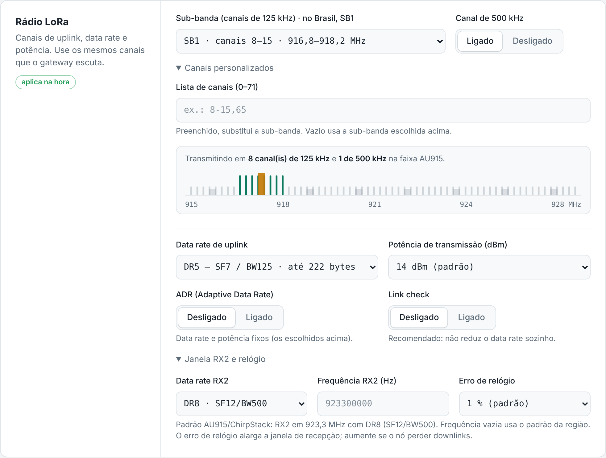
</p>

- **Sub-banda** 0–7 (no Brasil, SB1 = canais 8–15) e **canal de 500 kHz** (64 + sub-banda). O desenho mostra os canais em uso.
- **Canais personalizados:** lista como `8-15,65`; quando preenchida, substitui a sub-banda.
- **Data rate** DR0–DR6 com o payload máximo de cada um, **potência** 2–20 dBm, **ADR** e **link check**.
- **Janela RX2 e relógio:** DR8–DR13, frequência (vazia = 923,3 MHz) e erro de relógio. Aumente o erro de relógio se o nó perder downlinks.

### 4. Uplink e 5. Reset remoto

<p align="center">
  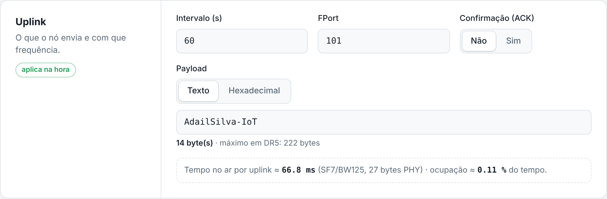
</p>

O payload pode ser **texto** ou **hexadecimal**. A página conta os bytes, avisa se passou do máximo do data rate e calcula o **tempo no ar** (cabeçalho LoRaWAN de 13 bytes incluído) e a **ocupação** do canal para o intervalo escolhido.

<p align="center">
  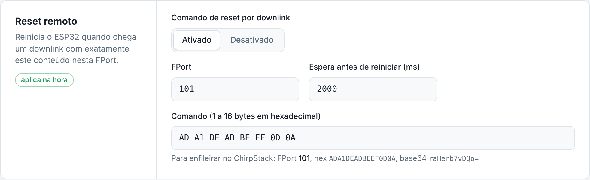
</p>

A dica abaixo do comando já mostra o **hex** e o **base64** prontos para enfileirar no ChirpStack. Detalhes em [Reset remoto por downlink](#-reset-remoto-por-downlink).

### 6. Rede Wi-Fi e 7. Inicialização

<p align="center">
  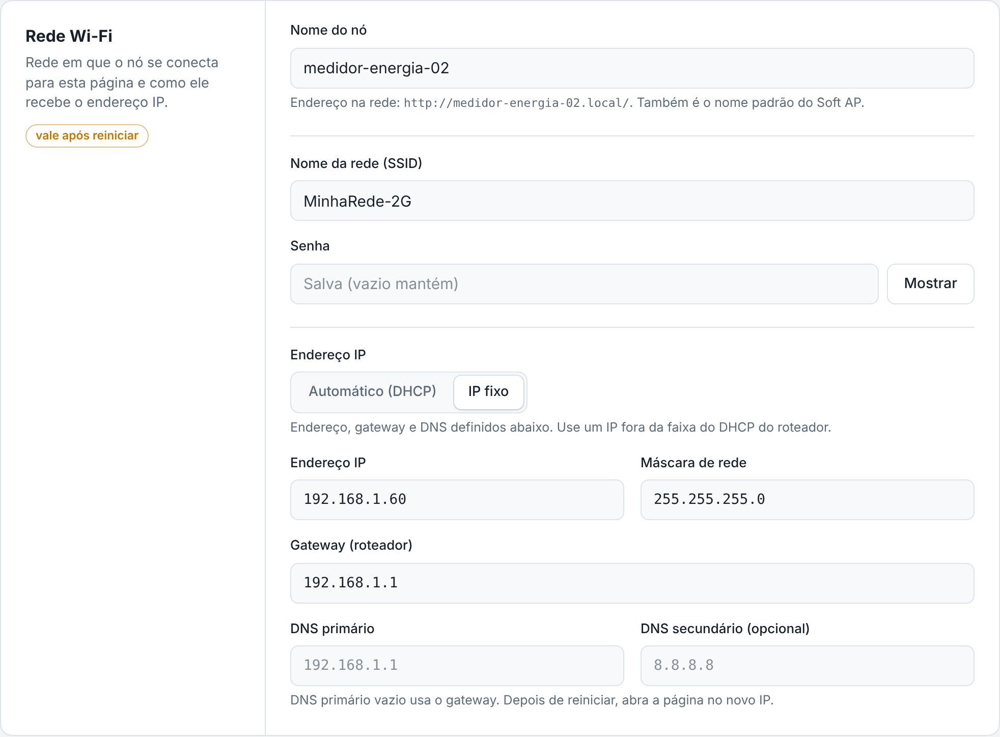
</p>

O **nome do nó** vira o hostname (`http://<nome>.local/`) e o nome padrão do Soft AP. **IP fixo** valida endereço, máscara, gateway e DNS no navegador antes de enviar.

<p align="center">
  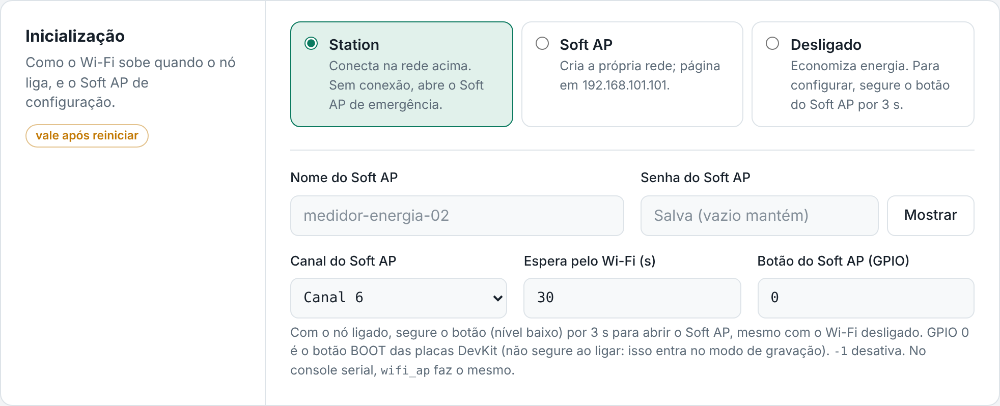
</p>

| Modo | Comportamento |
|---|---|
| **Station** | Conecta na rede; sem conexão em *Espera pelo Wi-Fi* segundos, abre o Soft AP de emergência |
| **Soft AP** | Cria a própria rede; página em `192.168.101.101` |
| **Desligado** | Sem Wi-Fi (menos consumo). O botão BOOT (3 s) ou `wifi_ap` abrem o Soft AP quando precisar |

### 8. Hardware

<p align="center">
  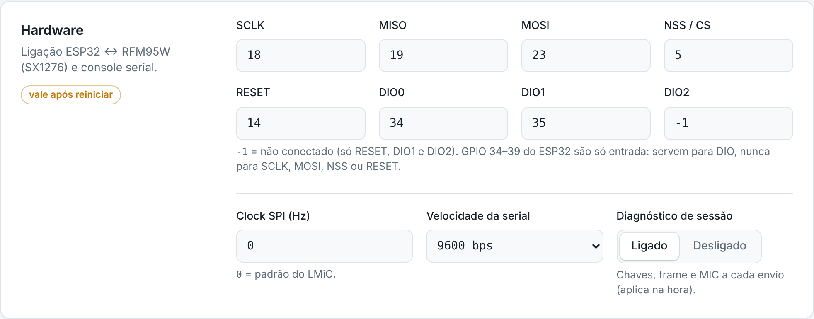
</p>

Pinos do RFM95W, clock SPI (`0` = padrão do LMiC), velocidade da serial e **diagnóstico de sessão** (chaves, frame e MIC a cada envio; vale na hora). Pinos e serial valem depois de reiniciar. Se os pinos estiverem errados, o LMiC não inicia, mas **a página continua funcionando** para você corrigir.

### 9. Acesso e 10. Manutenção

<p align="center">
  
</p>

<p align="center">
  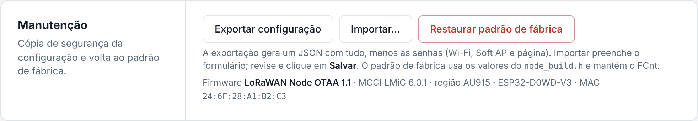
</p>

- **Exportar** baixa um JSON com toda a configuração, **menos as senhas**.
- **Importar** preenche o formulário a partir do JSON (avisa se o arquivo é de um nó ABP); revise e clique em **Salvar**.
- **Restaurar padrão de fábrica** apaga a configuração e reinicia com o `node_build.h`.

### Validação, salvar e sair

Os erros aparecem no topo do formulário e os campos com problema ficam em vermelho. O ESP32 valida tudo de novo antes de gravar.

<p align="center">
  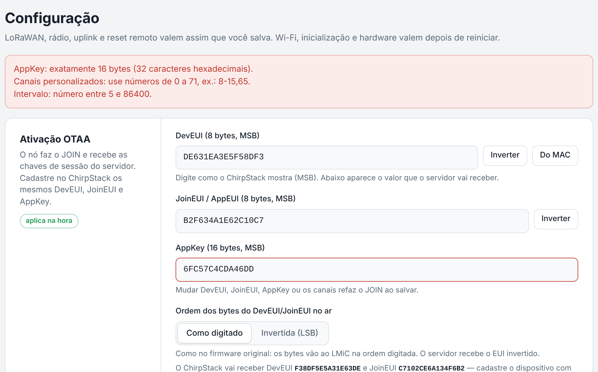
</p>

<p align="center">
  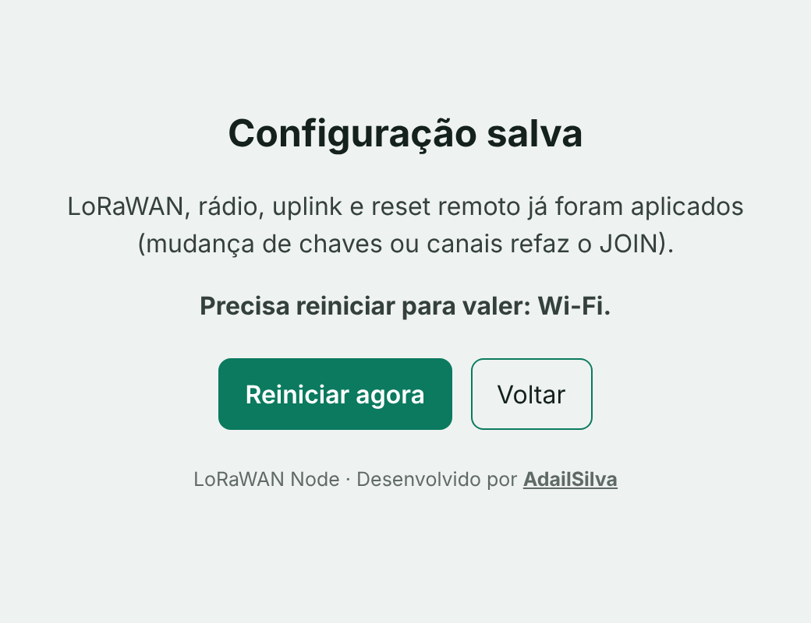
  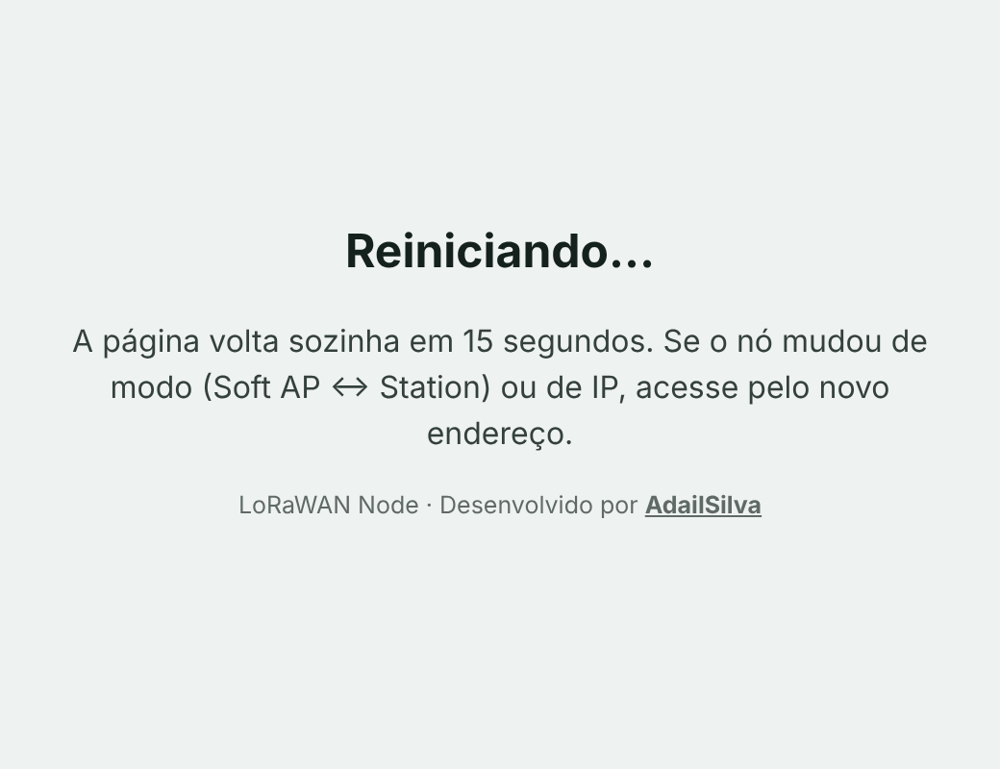
  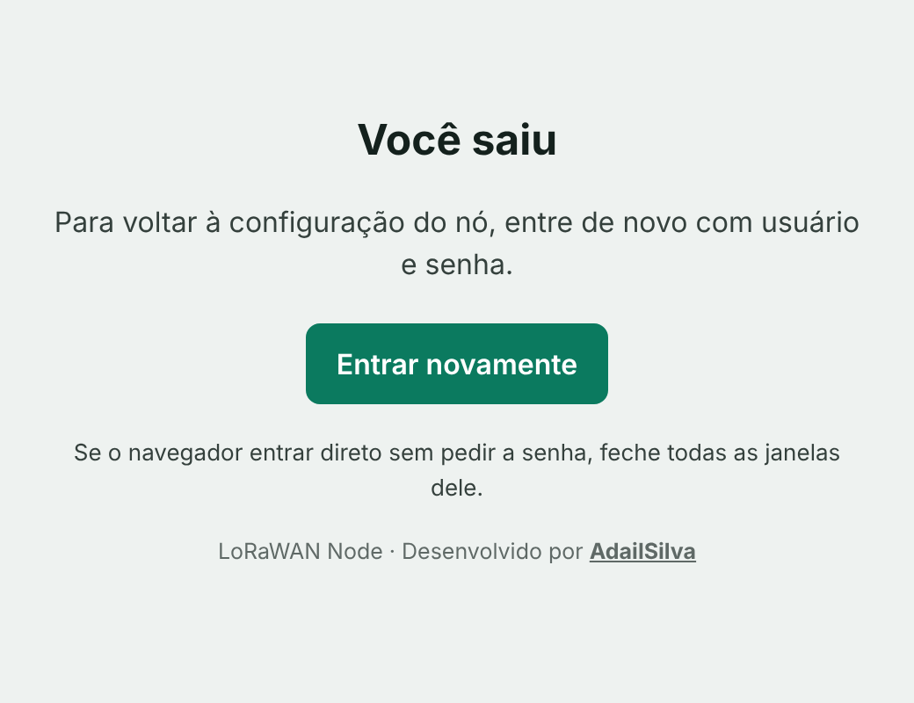
</p>

A barra inferior fica fixa e indica **alterações não salvas**; o navegador avisa se você tentar sair da página com alterações pendentes. Depois de salvar, a página diz o que já foi aplicado e o que **precisa de reinício**, e o painel de Status mantém esse aviso até reiniciar.

### Logs (`/logs`)

<p align="center">
  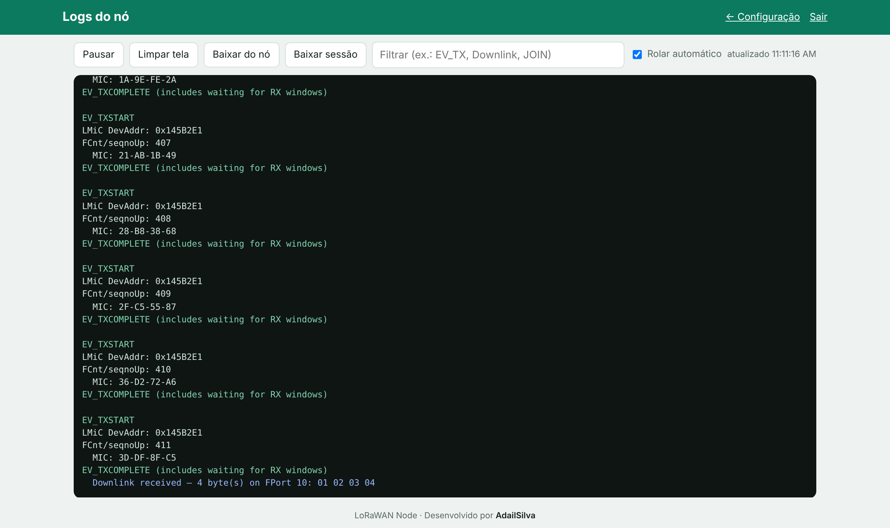
</p>

Tudo o que o firmware imprime no Serial Monitor, atualizado a cada 1,5 s, com cores por tipo (eventos, downlinks, avisos, erros), **filtro**, **pausa**, **rolar automático**, **Baixar do nó** (o buffer de 16 KB do ESP32) e **Baixar sessão** (o que a aba recebeu desde que abriu).

<p align="center">
  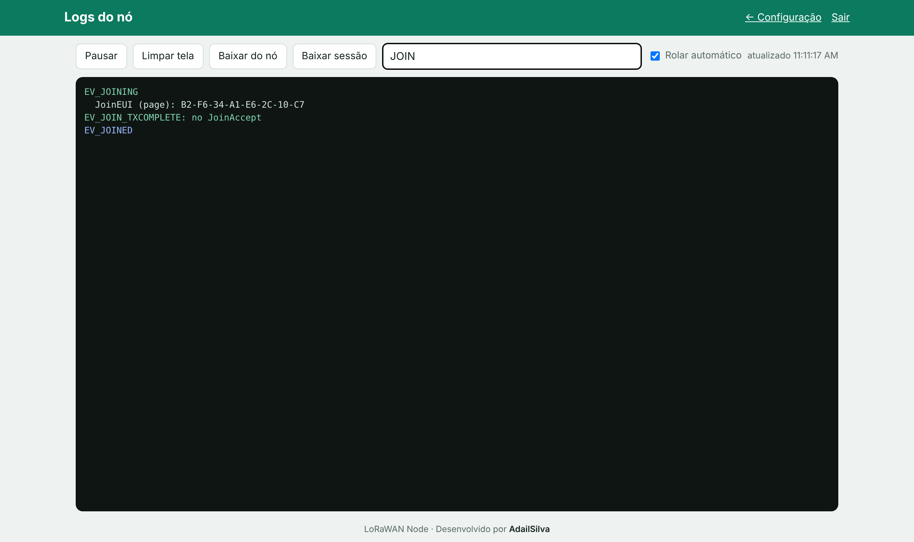
</p>

### Tema escuro e celular

<p align="center">
  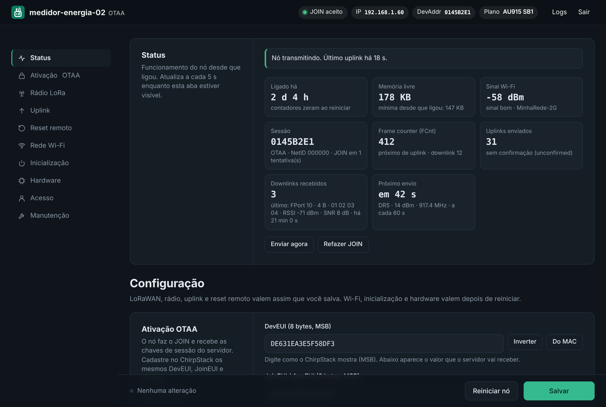
</p>

<p align="center">
  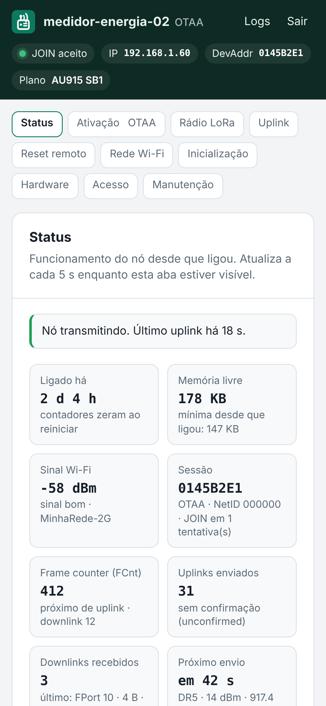
  &nbsp;&nbsp;
  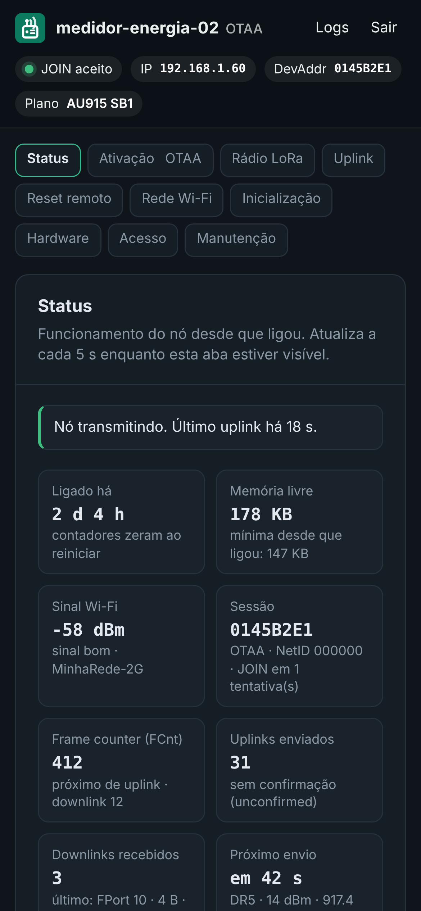
</p>

### Endereços HTTP

| Método | Caminho | Função |
|---|---|---|
| GET | `/` | Página principal (preenchida por JavaScript) |
| GET | `/config.json` | Configuração salva (sem senhas) |
| GET | `/status` | Status do nó e da sessão LoRaWAN (JSON) |
| POST | `/save` | Salva o formulário (`application/x-www-form-urlencoded`) |
| POST | `/action` | `a=send` · `a=restart` → JSON |
| POST | `/reboot` · `/factory` | Reinicia · restaura padrão de fábrica |
| GET | `/logs` · `/logs_data?from=<n>` · `/logs_download` | Página de logs · trecho novo · arquivo `.log` |
| GET | `/logout` · `/saiu` | Logout · tela “Você saiu” (sem login) |
| GET | `/favicon.svg` | Ícone (sem login) |

Todos pedem **HTTP Basic**, exceto os marcados “sem login”. Exemplo de leitura do status pela linha de comando:

```bash
curl -s -u admin:SUA_SENHA http://lorawan-node-otaa.local/status | jq .lw
```

---

## 🧰 Parâmetros e valores de fábrica

Valores de fábrica do [`node_build.h`](node_build.h). **Na hora** = sem reiniciar o ESP32.

| Seção | Parâmetro | Fábrica | Vale |
|---|---|---|---|
| Ativação | DevEUI | `DE631EA3E5F58DF3` | na hora (novo JOIN) |
| Ativação | JoinEUI / AppEUI | `B2F634A1E62C10C7` | na hora (novo JOIN) |
| Ativação | AppKey | do `node_build.h` | na hora (novo JOIN) |
| Ativação | Ordem dos bytes no ar | como digitado | na hora (novo JOIN) |
| Rádio | Sub-banda / canal 500 kHz | SB1 (8–15) / ligado (65) | na hora (novo JOIN) |
| Rádio | Canais personalizados | vazio | na hora |
| Rádio | Data rate / potência | DR5 (SF7/BW125) / 14 dBm | na hora |
| Rádio | ADR / link check | desligado / desligado | na hora |
| Rádio | RX2 data rate / frequência | DR8 / 923,3 MHz | na hora |
| Rádio | Erro de relógio | 1 % | na hora |
| Uplink | Intervalo | 10 s | na hora |
| Uplink | FPort / confirmado | 101 / não | na hora |
| Uplink | Payload | `AdailSilva-IoT` (texto) | na hora |
| Reset remoto | Ativado / FPort | sim / 101 | na hora |
| Reset remoto | Comando / espera | `AD A1 DE AD BE EF 0D 0A` / 2000 ms | na hora |
| Wi-Fi | Nome do nó | `lorawan-node-otaa` | reinício |
| Wi-Fi | SSID / senha / IP | vazio / vazio / DHCP | reinício |
| Inicialização | Modo | Station (com Soft AP de emergência) | reinício |
| Inicialização | Soft AP: nome / senha / canal | nome do nó / `lorawan101` / 6 | reinício |
| Inicialização | Espera pelo Wi-Fi / botão | 30 s / GPIO 0 | reinício |
| Hardware | SCLK, MISO, MOSI, NSS | 18, 19, 23, 5 | reinício |
| Hardware | RESET, DIO0, DIO1, DIO2 | 14, 34, 35, -1 | reinício |
| Hardware | Clock SPI / serial | 0 (padrão LMiC) / 9600 | reinício |
| Hardware | Diagnóstico de sessão | ligado | na hora |
| Acesso | Usuário / senha | `admin` / `lorawan` | na hora |

A configuração fica na NVS em `nodecfg/cfg` (um blob versionado: firmwares futuros podem acrescentar campos sem perder os antigos).

---

## 💻 Console serial

Serial Monitor com final de linha **Newline**.

| Comando | Faz |
|---|---|
| `help` | Lista os comandos |
| `status` | Estado do JOIN, DevAddr, FCnt, uplinks, downlinks, heap e endereço da página |
| `wifi_ap` | Abre o Soft AP de configuração agora |
| `web_auth --reset` | Login da página volta para `admin` / `lorawan` (vale na hora) |
| `send` | Envia um uplink agora |
| `rejoin` | Refaz o JOIN |
| `cfg_reset` | Apaga a configuração e reinicia com o padrão de fábrica |
| `reboot` | Reinicia o ESP32 |

---

## 📡 Plano de canais AU915

<p align="center">
  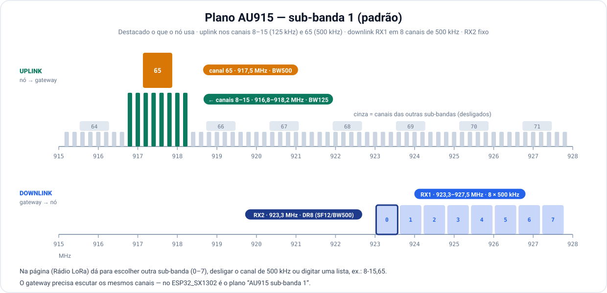
</p>

O AU915 tem 64 canais de 125 kHz (8 sub-bandas de 8) e 8 de 500 kHz. Este firmware usa por padrão a **sub-banda 1** (canais 8–15 + 65), a mesma do ChirpStack com `region_config = au915_1` e do plano “AU915 sub-banda 1” do gateway [ESP32_SX1302](https://github.com/AdailSilva/ESP32-with-SX1302-Gateway).

| Canal | Frequência (MHz) | BW (kHz) | DR | Uso |
|---|---|---|---|---|
| 8–15 | 916,8 a 918,2 (passo 0,2) | 125 | DR0–DR5 | Uplink |
| 65 | 917,5 | 500 | DR6 | Uplink / JOIN / ADR |
| RX1 0–7 | 923,3 a 927,5 (passo 0,6) | 500 | DR8–DR13 | Downlink |
| **RX2** | **923,3** | **500** | **DR8 (SF12)** | **Downlink fixo** |

> ⚠️ **Gateway e nó precisam usar a mesma sub-banda.** Se o gateway escuta a SB0 (0–7 + 64) e o nó transmite na SB1, os frames não chegam ao ChirpStack.

---

## 🤝 JOIN OTAA

<p align="center">
  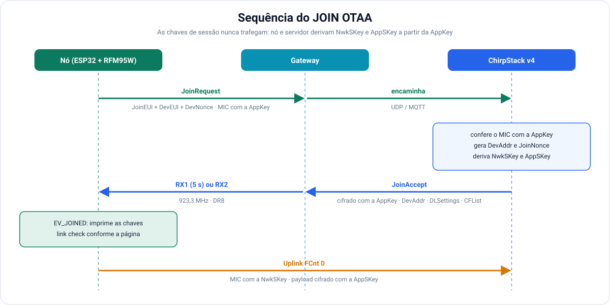
</p>

No JOIN, nó e servidor derivam as chaves de sessão (**NwkSKey** e **AppSKey**) a partir da **AppKey**; elas nunca trafegam pela rede. O servidor atribui o **DevAddr** no JoinAccept, junto com a configuração de canais e da RX2.

| Evento no Serial | Significado | Painel |
|---|---|---|
| `EV_JOINING` | Início do JOIN; imprime DevEUI/JoinEUI e o DevEUI como o servidor vai receber | “Iniciando o JOIN…” |
| `EV_JOIN_TXCOMPLETE: no JoinAccept` | JoinRequest enviado sem resposta; o LMiC tenta de novo com backoff | “Aguardando o JOIN (tentativa n)” |
| `EV_JOINED` | Sessão estabelecida; imprime NetID, DevAddr e chaves de sessão | “JOIN aceito” |
| `EV_JOIN_FAILED` | Falha definitiva | aviso |

- O JoinRequest pode sair em qualquer canal habilitado, inclusive o **65** (500 kHz). Mantenha os canais iguais aos do gateway.
- Depois do JOIN, o FCnt começa em 0 e é controlado pelo LMiC; não precisa de NVS. Cada reinício faz um JOIN novo.
- O link check é reaplicado em `EV_JOINED` (o JOIN o liga de novo automaticamente) conforme a opção da página.

---

## 🔁 Ordem dos bytes do DevEUI/JoinEUI

<p align="center">
  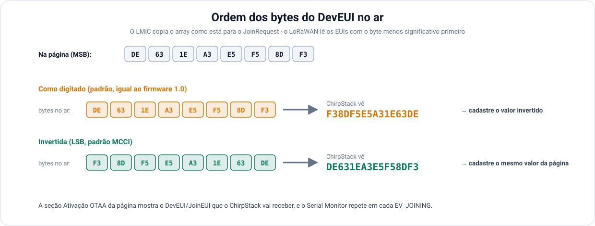
</p>

O LMiC copia os bytes de `os_getDevEui()`/`os_getArtEui()` **exatamente como estão** para o JoinRequest, e o LoRaWAN transporta EUIs com o **byte menos significativo primeiro**. Por isso a documentação da MCCI pede esses dois valores em LSB.

A versão 1.0 deste firmware entregava os arrays em **MSB**. Resultado: o ChirpStack recebe o DevEUI **invertido** (`DE631EA3E5F58DF3` chega como `F38DF5E5A31E63DE`). Para não quebrar um nó que já está cadastrado assim, o padrão continua **“Como digitado”** (igual à 1.0).

| Opção na página | Bytes entregues ao LMiC | O ChirpStack recebe | Cadastre no ChirpStack |
|---|---|---|---|
| **Como digitado** (padrão) | `DE 63 1E A3 E5 F5 8D F3` | `F38DF5E5A31E63DE` | o valor **invertido** |
| **Invertida (LSB)** | `F3 8D F5 E5 A3 1E 63 DE` | `DE631EA3E5F58DF3` | o **mesmo** valor da página |

A seção **Ativação OTAA** mostra os valores que o ChirpStack vai receber, e o Serial Monitor repete em cada `EV_JOINING`. A **AppKey** não é afetada: vai sempre em MSB.

---

## 🔄 Reset remoto por downlink

<p align="center">
  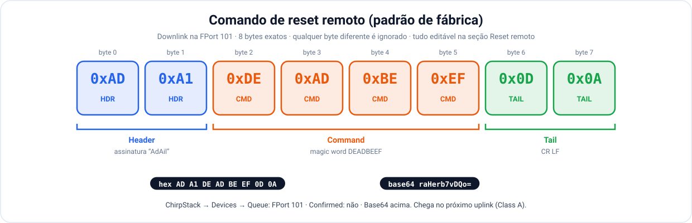
</p>

Reinicia o ESP32 em campo, sem acesso físico, com um downlink numa FPort dedicada. O comando é comparado **byte a byte** e com **tamanho exato**, para que nenhum downlink comum reinicie o nó por acidente. Tudo é configurável na seção **Reset remoto** (liga/desliga, FPort, 1–16 bytes, espera).

| Campo | Fábrica |
|---|---|
| FPort | `101` (0x65) |
| Payload | `AD A1 DE AD BE EF 0D 0A` (8 bytes) |
| Base64 | `raHerb7vDQo=` |
| Espera antes de reiniciar | 2000 ms |

| Segmento | Bytes | Valor | Significado |
|---|---|---|---|
| Header | 0–1 | `0xAD 0xA1` | Assinatura “**Ad**ail Silv**a1**” |
| Command | 2–5 | `0xDE 0xAD 0xBE 0xEF` | Palavra mágica de reset |
| Tail | 6–7 | `0x0D 0x0A` | Fim de quadro (CR LF) |

Regras: FPort diferente → o downlink é só exibido; tamanho ou qualquer byte diferente → ignorado, e o Serial mostra o esperado e o recebido; comando certo → reinicia depois da espera.

### Enviar pelo ChirpStack

**Interface web:** *Devices → seu device → Queue → Add item* · FPort `101` · Confirmed: não · Base64 `raHerb7vDQo=`. O downlink fica na fila até o próximo uplink (Class A).

**MQTT (ChirpStack v4, TLS):**

```bash
export MQTT_HOST="chirpstack.seu-dominio.com.br"
export MQTT_USER="seu-usuario"
export MQTT_PASS="sua-senha"          # nunca deixe a senha real no repositório
APP_ID="<id-da-application>"
DEV_EUI="<deveui-como-o-chirpstack-mostra>"

mosquitto_pub -h "$MQTT_HOST" -p 8883 --cafile ca.crt \
  -u "$MQTT_USER" -P "$MQTT_PASS" \
  -t "application/$APP_ID/device/$DEV_EUI/command/down" \
  -m '{"devEui":"'"$DEV_EUI"'","confirmed":false,"fPort":101,"data":"raHerb7vDQo="}'
```

Para gerar o base64 de outro comando: `printf '\xAD\xA1\xDE\xAD\xBE\xEF\x0D\x0A' | base64` (ou copie da dica na própria página).

### No Serial Monitor

```
EV_TXCOMPLETE (includes waiting for RX windows)
  Downlink received — 8 byte(s) on FPort 101: AD A1 DE AD BE EF 0D 0A
  [RESET PORT] Command received on FPort 101 — validating...
  [RESET] Valid reset command — rebooting in 2000 ms...
```

Payload errado:

```
  Downlink received — 8 byte(s) on FPort 101: AD A1 DE AD BE EF 0D FF
  [RESET PORT] Command received on FPort 101 — validating...
  [RESET] Invalid payload — command ignored.
  Expected: AD A1 DE AD BE EF 0D 0A
  Received: AD A1 DE AD BE EF 0D FF
```

---

## 🔍 Diagnóstico de sessão e MIC

Com **Hardware → Diagnóstico de sessão** ligado (padrão), cada `EV_TXSTART` imprime as chaves que o LMiC está usando, o DevAddr, o **frame completo** em hex, os FCnt e o **MIC** (últimos 4 bytes). Compare o MIC com o campo `mic` do frame no ChirpStack/gateway (no JSON ele vem em decimal):

```bash
printf '%02X-%02X-%02X-%02X\n' 20 46 220 190     # → 14-2E-DC-BE
```

MIC igual nos dois lados = chaves certas. MIC diferente = chave divergente.

<details>
<summary><b>Calcular o MIC à mão (Python e Java)</b></summary>

```
MIC = AES-128-CMAC(NwkSKey, B0 | msg)[0:4]
B0  = 0x49 | 0x00×4 | Dir=0 | DevAddr(LE,4) | FCnt(LE,4) | 0x00 | len(msg)
msg = MHDR | DevAddr(LE,4) | FCtrl | FCnt(LE,2) | FPort | FRMPayload
```

**Python** (`pip install pycryptodome`):

```python
from Crypto.Hash import CMAC
from Crypto.Cipher import AES
import struct

def calcular_mic(nwkskey_hex, devaddr_hex, fcnt, frame_sem_mic_hex):
    nwkskey    = bytes.fromhex(nwkskey_hex)
    devaddr_le = bytes.fromhex(devaddr_hex)[::-1]   # big-endian → little-endian
    msg        = bytes.fromhex(frame_sem_mic_hex)
    b0 = (bytes([0x49, 0, 0, 0, 0, 0]) + devaddr_le +
          struct.pack('<I', fcnt) + bytes([0x00, len(msg)]))
    c = CMAC.new(nwkskey, ciphermod=AES)
    c.update(b0 + msg)
    return c.digest()[:4].hex()

print(calcular_mic("151f7779d7aaee422a74568380db7045", "00aa88ca", 0,
                   "40CA88AA0000000001F56CB7FFFA9C7C0D6C6C72368ECD"))   # → 142edcbe
```

**Java 17+** (só `javax.crypto`):

```java
import javax.crypto.Cipher;
import javax.crypto.spec.IvParameterSpec;
import javax.crypto.spec.SecretKeySpec;
import java.nio.ByteBuffer;
import java.nio.ByteOrder;
import java.util.HexFormat;

public class LoRaWANMic {
    public static String calcularMic(String nwksKeyHex, String devAddrHex, int fcnt, String frameHex) throws Exception {
        HexFormat hex = HexFormat.of();
        byte[] key = hex.parseHex(nwksKeyHex), da = hex.parseHex(devAddrHex), msg = hex.parseHex(frameHex);
        byte[] fc = ByteBuffer.allocate(4).order(ByteOrder.LITTLE_ENDIAN).putInt(fcnt).array();
        byte[] b0 = {0x49, 0, 0, 0, 0, 0, da[3], da[2], da[1], da[0], fc[0], fc[1], fc[2], fc[3], 0, (byte) msg.length};
        byte[] data = new byte[16 + msg.length];
        System.arraycopy(b0, 0, data, 0, 16);
        System.arraycopy(msg, 0, data, 16, msg.length);
        return hex.formatHex(aesCmac(key, data), 0, 4);
    }

    static byte[] aesCmac(byte[] key, byte[] data) throws Exception {      // RFC 4493
        byte[] k1 = sub(aes(key, new byte[16])), k2 = sub(k1);
        int n = Math.max(1, (data.length + 15) / 16);
        boolean full = data.length > 0 && data.length % 16 == 0;
        byte[] last = new byte[16];
        int off = (n - 1) * 16, sz = data.length - off;
        System.arraycopy(data, off, last, 0, sz);
        if (full) xor(last, k1); else { last[sz] = (byte) 0x80; xor(last, k2); }
        byte[] x = new byte[16];
        for (int i = 0; i < n - 1; i++) {
            byte[] b = new byte[16];
            System.arraycopy(data, i * 16, b, 0, 16);
            xor(b, x);
            x = aes(key, b);
        }
        xor(last, x);
        return aes(key, last);
    }

    static byte[] aes(byte[] key, byte[] block) throws Exception {
        Cipher c = Cipher.getInstance("AES/CBC/NoPadding");
        c.init(Cipher.ENCRYPT_MODE, new SecretKeySpec(key, "AES"), new IvParameterSpec(new byte[16]));
        return c.doFinal(block);
    }

    static byte[] sub(byte[] in) {
        byte[] o = new byte[16];
        for (int i = 0; i < 15; i++) o[i] = (byte) ((in[i] << 1) | ((in[i + 1] & 0xFF) >> 7));
        o[15] = (byte) (in[15] << 1);
        if ((in[0] & 0x80) != 0) o[15] ^= (byte) 0x87;
        return o;
    }

    static void xor(byte[] a, byte[] b) { for (int i = 0; i < 16; i++) a[i] ^= b[i]; }

    public static void main(String[] args) throws Exception {
        System.out.println(calcularMic("151f7779d7aaee422a74568380db7045", "00aa88ca", 0,
                "40CA88AA0000000001F56CB7FFFA9C7C0D6C6C72368ECD"));   // → 142edcbe
    }
}
```

</details>

---

## 🧾 Saída no Serial Monitor

9600 baud (padrão). Exemplo de boot e uplink:

```
Starting — LoRaWAN Node OTAA 1.1 (MCCI LMiC 6.0.1)
Node "lorawan-node-otaa" · region AU915 · config loaded from NVS
[WEB] Página: http://lorawan-node-otaa.local/ (ou o IP que aparecer abaixo). Sem Wi-Fi em 30 s abre o Soft AP "lorawan-node-otaa".
[WEB] Segure o GPIO 0 em nível baixo por 3 s para abrir o Soft AP a qualquer momento.
Pins: SCLK 18 MISO 19 MOSI 23 NSS 5 RST 14 DIO0 34 DIO1 35 DIO2 -1
  Channels: 9 enabled (sub-band from config)
Packet queued.
EV_JOINING
  DevEUI  (page): DE-63-1E-A3-E5-F5-8D-F3
  JoinEUI (page): B2-F6-34-A1-E6-2C-10-C7
  DevEUI as the server receives it: F38DF5E5A31E63DE  (byte order: as typed)

EV_TXSTART
EV_JOIN_TXCOMPLETE: no JoinAccept

EV_TXSTART
EV_JOINED
  netid:   0
  devaddr: 0x145B2E1
  AppSKey: 3C-0E-91-7A-55-D2-18-B4-C9-60-2F-7E-A1-04-8B-D3
  NwkSKey: 9E-21-6B-F0-43-AA-7C-15-D8-36-E2-0B-59-C4-71-AF

EV_TXSTART
LMiC DevAddr: 0x145B2E1
FCnt/seqnoUp: 0
  MIC: 9A-1F-3B-E2
EV_TXCOMPLETE (includes waiting for RX windows)
```

As mesmas linhas aparecem na página **Logs**.

---

## 📝 Cadastro no ChirpStack

### Device profile

| Campo | Valor |
|---|---|
| Region | `AU915` |
| Region configuration | `au915_1` |
| MAC version | `LoRaWAN 1.0.3` |
| Regional parameters revision | `B` |
| Supports OTAA | ✅ Sim |
| Supports Class-C | ☐ Não |

### Device e OTAA keys

| Campo no ChirpStack | Campo na página |
|---|---|
| Device EUI | DevEUI **como o ChirpStack vai receber** (linha abaixo de “Ordem dos bytes” na Ativação OTAA) |
| Join EUI | JoinEUI (mesma observação) |
| Application key (*OTAA keys*) | AppKey |

Depois de ligar o nó, confira em **Devices → device → Events** o evento `join`. Na aba **Activation** aparecem DevAddr, NwkSKey e AppSKey: devem bater com o Serial Monitor e com o painel de Status.

---

## 🔀 Diferenças em relação ao ABP

| Aspecto | OTAA (este repositório) | [ABP](https://github.com/AdailSilva/esp32-lorawan-abp-au915-chirpstack) |
|---|---|---|
| Credenciais | DevEUI + JoinEUI + AppKey | DevAddr + NwkSKey + AppSKey + NetID |
| Chaves de sessão | Derivadas a cada JOIN | Fixas |
| DevAddr | Atribuído pelo servidor | Configurado na página |
| Frame counter | Zera a cada JOIN | Persistido na NVS |
| Primeira transmissão | Depois do JoinAccept | Imediata |
| LMiC | 6.0.1 | 3.3.0 (a 6.x quebra o MIC do ABP 1.0.x) |
| Ações na página | Refazer JOIN | Reprovisionar sessão, Alterar FCnt |
| Segurança | **Maior** | Menor (recomendado só para testes) |

---

## 🩺 Solução de problemas

| Sintoma | Causa provável | Solução |
|---|---|---|
| Não acho a página | Wi-Fi não conectou / IP desconhecido | Veja o IP no Serial Monitor; espere 30 s pelo Soft AP de emergência; ou segure o BOOT 3 s |
| `.local` não abre | mDNS bloqueado (algumas redes Android/Windows) | Use o IP mostrado no Serial Monitor ou no painel do roteador |
| Esqueci a senha da página | — | `web_auth --reset` no Serial Monitor |
| Navegador entra sem pedir senha depois de **Sair** | Login guardado em outra janela | Feche todas as janelas do navegador |
| `LMiC init FAILED — check the pins` | Pinos errados na seção Hardware | Corrija na página (ela continua funcionando) e reinicie |
| Salvei e nada mudou no Wi-Fi/pinos | Esses campos valem após reiniciar | Use **Reiniciar nó**; o Status avisa o que está pendente |
| Página lenta enquanto transmite | Normal: TX/RX tem prioridade | Os comandos esperam o fim do TX/RX e são aplicados em seguida |
| `multiple definition of 'hal_init'` | Conflito LMiC × ESP32 core 3.x | Renomeie a `hal_init` da LMiC com `sed` (como no README do ABP) |
| `EV_JOIN_TXCOMPLETE: no JoinAccept` sem parar | DevEUI invertido, AppKey errada, canais diferentes do gateway, gateway offline | Compare o DevEUI “como o servidor recebe” com o cadastro; confira AppKey; use a mesma sub-banda; veja os Events do device |
| JOIN aceito, mas sem downlinks | Device profile com Class-C ou RX2 errado | Desligue Class-C; RX2 DR 8 / 923,3 MHz |
| Payload descartado | Maior que o máximo do data rate | A página avisa o máximo por DR (DR0–DR2: 51 bytes) |
| Downlinks não chegam | Device profile com **Supports Class-C** | Desligue Class-C e limpe a fila do device |
| Muitos downlinks perdidos | Janela de recepção estreita | Aumente **Erro de relógio** (Rádio LoRa → Janela RX2 e relógio) |

---

## 📁 Estrutura do repositório

```
LoRaWAN_Node_Base_OTAA/
├── LoRaWAN_Node_Base_OTAA.ino       ← sketch: eventos LMiC, uplink, reset, comandos
├── node_build.h                     ← modo OTAA + valores de fábrica
├── node_config.h / node_config.cpp  ← configuração na NVS e validação
├── node_state.h  / node_state.cpp   ← status e comandos (loop ↔ web)
├── node_web.h    / node_web.cpp     ← Wi-Fi, portal cativo, mDNS e servidor WEB
├── node_page.h                      ← páginas HTML/CSS/JS
├── node_log.h    / node_log.cpp     ← log em RAM para a página Logs
├── doc/images/                      ← diagramas (SVG) e capturas da interface (PNG)
├── .gitattributes
├── LICENSE
└── README.md
```

Os arquivos `node_*` são **idênticos** nos repositórios ABP e OTAA; só mudam o `node_build.h` e o sketch.

---

## 📜 Licença e autor

MIT — veja [LICENSE](LICENSE).

**Adail dos Santos Silva** · [k8s.adailsilva.com.br](https://k8s.adailsilva.com.br/) · adail101@hotmail.com · WhatsApp +55 89 9 9412-9256
